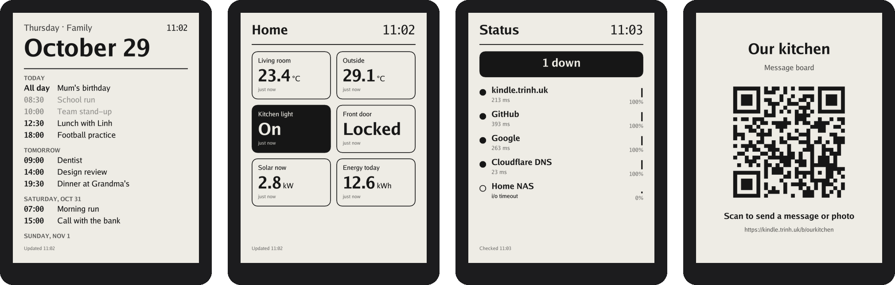
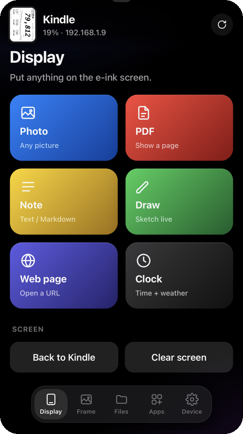
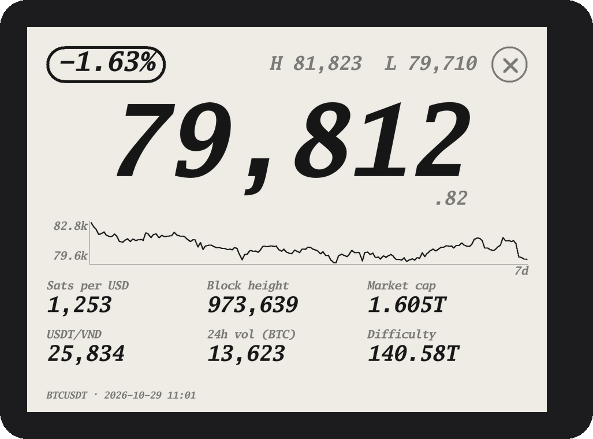

# Kindle Unlocked

Turn a Kindle into a tiny always-on computer: unlock it from its own browser, then install apps with one line.

**Website:** https://kindle.trinh.uk (English · 中文 · Tiếng Việt)



<sub>Calendar · Home Assistant · Monitor · Message Board: always-on wall panels, set up from your phone.</sub>

## How it works

1. **Find your Kindle**: the site reads your serial number and software version, then picks the right unlock method. The live table comes from [kindlemodding.org](https://kindlemodding.org).
2. **Unlock it**: most Kindles from 2019 onwards unlock straight from the Kindle's own browser (SpiderCat, Véra, Sanctuary), with no computer or cable.
3. **Add apps**: copy [`ku-setup.sh`](https://kindle.trinh.uk/ku-setup.sh) into the Kindle's `documents` folder and tap it in the Library. It connects the app store and installs HTTP Server. Or type this in the Home search bar (it doesn't work on 5.12, which blocks dots in search commands):
   ```
   ;kpm add-repo kindle.trinh.uk/r
   ;kpm update
   ;kpm install ku-http
   ```
4. **Use your phone**: open HTTP Server on the Kindle, scan its QR code, and install or set up every other app from the Remote's Apps tab.

## Apps

| Package | What it does |
|---|---|
| `ku-http` | **HTTP Server**: hosts a website, plus an optional **Remote** web app for your phone. Remote pairs with a QR code and can show photos, PDFs, notes and drawings on the screen. It also runs a photo frame, sends books, takes screenshots, controls the light, runs scripts, and has an HTTP API. |
| `ku-board` | **Message Board**: family members send notes and photos from `kindle.trinh.uk/b/…` |
| `ku-calendar` | **Calendar**: agenda from iCal links (Google Calendar…) and Todoist tasks |
| `ku-ha` | **Home Assistant**: wall panel showing your entities |
| `ku-monitor` | **Monitor**: uptime checks with history and ntfy alerts |
| `ku-btc` | **BTC Ticker**: big Bitcoin price, 7-day chart and network stats, drawn natively (no browser) to run for months; tap the price to rotate |
| `ku-ssh` | SSH + SFTP server |
| `ku-tailscale` | Joins your Tailscale network (userspace networking, so no TUN is needed) |
| `ku-dash` | Always-on web page (demo: `kindle.trinh.uk/d`) |
| `ku-awake` | Keeps the Kindle (and Wi-Fi) awake |
| `ku-update` | One tap to update every app |

<table>
<tr>
<td align="center" valign="top"><br><sub><b>Remote</b> on your phone: put photos, PDFs, notes, drawings or a web page on the screen, and install and set up apps.</sub></td>
<td align="center" valign="top"><br><sub><b>BTC Ticker</b>: tap the price to rotate. Currency, update rate and language are set from the Remote.</sub></td>
</tr>
</table>

**PC Mirror** shows your computer screen on the Kindle. It needs `ku-http` with Remote on.

- Mac: `curl -fsSL kindle.trinh.uk/mirror.sh | bash`
- Windows: `irm kindle.trinh.uk/mirror.ps1 | iex`

## Layout

```
cmd/ku-sshd     SSH/SFTP server (Go)
cmd/ku-httpd    HTTP Server + Remote web app (Go, web/ embedded)
cmd/ku-panel    e-ink panels: board, calendar, ha, monitor, btc (Go)
internal/kindle drawing on the e-ink screen, lipc, framebuffer
packages/       KPM packages (shell hooks + scriptlets); _lib/ku.sh is shared
public/         kindle.trinh.uk static site, board page, mirror scripts, ku-setup.sh
docs/img/       README screenshots (panels rendered with ku-panel -out)
worker/         Cloudflare Worker: /r repo, /d dashboard, /b board, APIs
scripts/        build.sh (ARMv7 binaries + .kpkg repo)
```

## Build & deploy

```
npm install
npm run build    # Go cross-compile (GOARCH=arm GOARM=7) + pack public/repo/*.kpkg
npm run deploy   # build + wrangler deploy
```

Render a panel on your computer to try it:

```
go run ./cmd/ku-panel -mode calendar -ku /tmp/ku -out calendar.png -size 1072x1448
```

## Credits

Unlock methods come from the [KindleModding](https://github.com/KindleModding) community, and packages install through their [KPM](https://github.com/KindleModding/KPM) package manager. Unlocking is at your own risk.

## License

MIT
